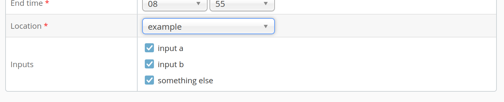

Capture Agent Configuration
===========================

The configuration your agent sends to the core must accurately reflect both the agent's *current* state, as well as its
*possible* states.  These configuration options will be used to present the Opencast administrative user(s) with
capture options, depending on agent configuration.

Required Configuration Keys
---------------------------

A CA API 2.x agent *MUST* populate the following keys with human readable strings of between 1 and 256 UTF8 characters.

- `vendor.name`: Set to the capture agent vendor's name
- `vendor.model`: Set to the capture agent's model
- `vendor.hardware`: Set to the capture agent's hardware revision
- `vendor.firmware`: Set to the capture agent's firmware revision

Agent which do not populate all of these keys will be treated as CA API 1.x agents.

Capture Mode Keys
-----------------

Your agent *MUST* populate at least one of the following keys with a `1`

- `capture.local.capable`: Whether the CA is capable of capturing to local storage
- `capture.stream.capable`: Whether the CA is capable of streaming its inputs to a remote server

Agents which do not populate at least one of these keys are rejected with an HTTP 400.


Capture Autostart
-----------------

Agents which support priming their capture pipline(s), but not actually storing/streaming data at event start can
indicate such support by setting a `1` for the flag `capture.local.canstartpaused` for local capture, and
`capture.stream.canstartpaused` for streaming.  Both flags require their respective `capable` flags to be set, and will
otherwise be ignored.

If your device indicates this support it must provide a vendor specified way to trigger the actual capture of data.
Agents in this paused state *MAY* instead choose to replace their inputs with a vendor specified waiting image or video
rather than not capturing.  In either case, the end time of the event should remain the same.  In the case of an event
which is never completely started, this will lead to data loss, however Opencast's scheduling system does not account
for agent-led schedule alterations.


Capture Local Configurations
----------------------------

FIXME: This isn't built and wasn't discussed.  Do we need/want this?


Capture Stream Configurations
-----------------------------

An agent which supports streaming can define one or more capture stream configurations for per-event configuration.
If your agent supports this it should provide a set of comma delimited plain text strings, each no longer than 32 utf8
characters, under the `capture.stream.configuration` agent configuration key.  These strings are vendor specific, but
should generally indicate frame size and rate, as well as bitrate.  If you agent does not support per-event stream
configuration, you should omit this configuration key.  Agents which attempt to configure an empty list, or pass one or
more configurations longer than 32 utf8 characters will be rejected with an HTTP 400.


Capture Device Positions
------------------------

An agent which supports directly controlling PTZ cameras can define one or more device positions.  If your agent
supports this it should provide a set of comma delimited plain text strings, each no longer than 256 utf8 characters,
under the `capture.device.positions` agent configuration key.  These strings are vendor specific, but you should expect
these to be directly visible to Opencast administrative users and thus be clear for end users.  If you agent does not
support per-event device positions, you should omit this configuration key.  Agents which attempt to configure an empty
list, or pass one or more configurations longer than 256 utf8 characters will be rejected with an HTTP 400.


Capture Agent Input Selection
=============================

Capture agents usually run autonomous with a minimum of user interaction.
One of the few ways for users to interact is the optional input selection which may be shown when scheduling events.
It allows capture agents to present a set of inputs which users can select for each event
and which are returned to the capture agent as part of the schedule.

A capture agent may specify and change potential inputs at any time.
Users will select inputs when scheduling at which point the selection is stored and will not be updated by future
capture agent specification changes.


Setting Input Options
---------------------

For setting input options, the capture agent can use the REST endpoint `POST /agents/{name}/configuration`.

The payload must represent Java properties and can be provided as JSON or XML.
The configuration key used for input selection is `capture.device.names`.
The value for this key is a comma separated list of options.

For example, to define three options `input a`, `input b` and `something else`, send a payload like this:

```json
{"capture.device.names":"input a,input b,something else"}
```

Use [the REST docs](https://develop.opencast.org/docs.html?path=/capture-admin#setAgentStateConfiguration-4)
to try this.

from now one, the options will automatically show up as input fields in the admin interface when the capture agent is
selected:




Receiving the selection
-----------------------

Capture agents get the selection as part of the scheduling information they retrieve via `GET /recordings/calendars`.
Each event may contain these selections.
They are encoded as a Java property file named `org.opencastproject.capture.agent.properties`.
It is up to the capture agent to act on these or not.

```ical
BEGIN:VCALENDAR
...
BEGIN:VEVENT
...
ATTACH;FMTTYPE=application/text;VALUE=BINARY;ENCODING=BASE64;X-APPLE-FILENAME=org.opencastproject.capture.agent.properties:Y2FwdHVyZS5kZXZpY2UubmFtZXM9aW5wdXQgYSxzb21ldGhpbmcgZWxzZQpvcmcub3BlbmNhc3Rwcm9qZWN0LndvcmtmbG93LmRlZmluaXRpb249ZmFzdApvcmcub3BlbmNhc3Rwcm9qZWN0LndvcmtmbG93LmNvbmZpZy5zdHJhaWdodFRvUHVibGlzaGluZz10cnVlCmV2ZW50LmxvY2F0aW9uPWV4YW1wbGUKZXZlbnQudGl0bGU9VGVzdAo=
...
```

Decoding this, the properties file may again contain a key `capture.device.names` with all selected options as comma
separated list:

```properties
capture.device.names=input a,something else
```
